Subject: IPC Website — How Everything Works (with pictures)

Hi Rick,

Your new website comes with its own dashboard, and everything on the site is yours to change — the catalog, your business details, the wording on every page, the photos, and the quote requests that come in. This email walks through how it all fits together, with a picture of each screen. The orange numbers in each picture match the numbered notes under it.

You don't need to read it all at once. Keep it, and come back to the part you need.

## 1. Two halves: the website, and your dashboard

**The website** is what customers see at www.insulationproducts.com. **The dashboard** is a private set of pages, behind a password, where you change it. There is nothing to "publish": when you save something in the dashboard, the website shows it within about a minute.

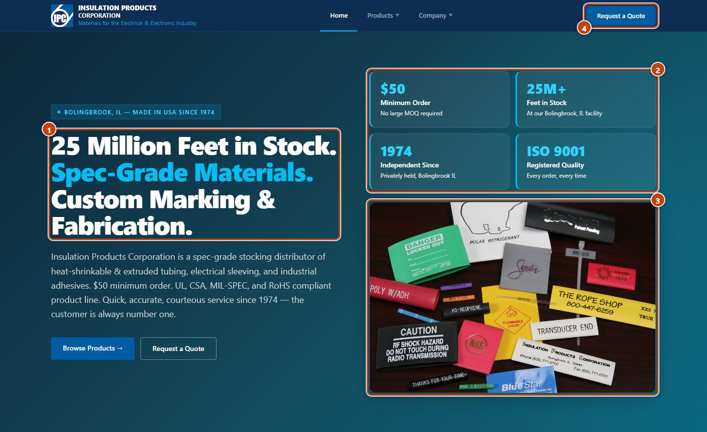

1. The headline, paragraph and buttons — **Page Content → Homepage — Hero**.
2. The four small cards — **Page Content → Homepage — Hero Proof Points**.
3. The big photo — **Site Images & Logo**.
4. The **Request a Quote** button — every page has one; it opens the Contact page.

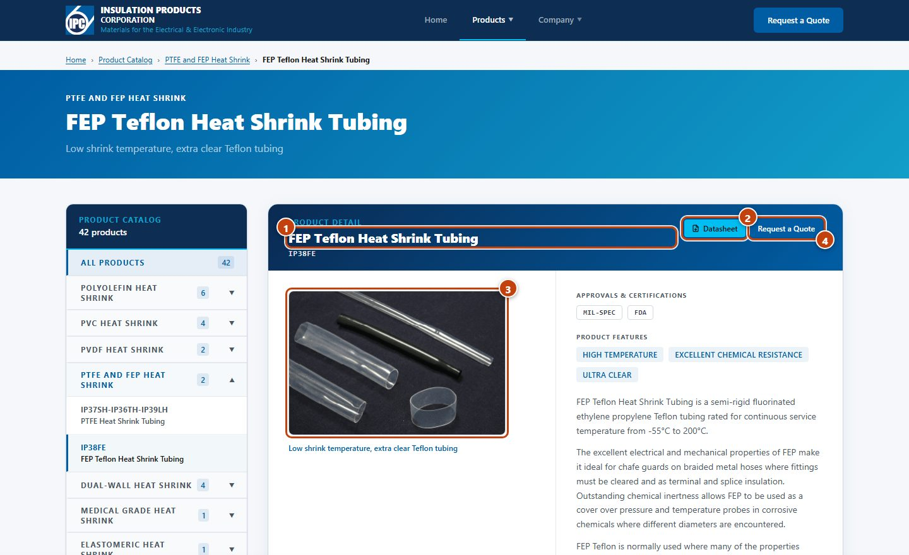

1. The product's name and part number — that product's **Edit** screen.
2. The **Datasheet** button — the product's **Manage PDF** screen.
3. The photo — the product's **Photo** screen.
4. **Request a Quote** opens the Contact page with this part number already filled in.

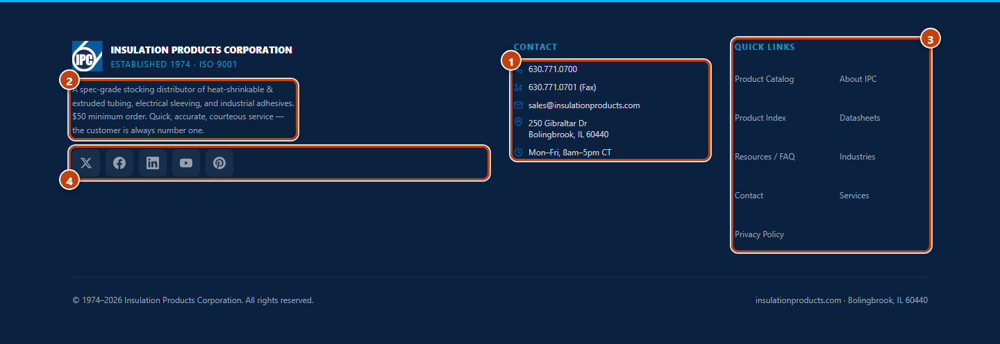

1. Phone, fax, email, address, hours — **Business Details**. Change the phone number once there and it changes on every page.
2. The short paragraph about IPC — **Page Content → Company Claims**.
3. Quick Links — **Page Content → Navigation — Footer Quick Links**.
4. The social media icons — **Business Details → Social Links** (an empty box removes the icon).

If you ever wonder where something on the site is changed, the dashboard's **Help** page has a section called **Where each part of the site is edited** that goes through every page, top to bottom.

## 2. Signing in

- Admin Dashboard: [https://www.insulationproducts.com/admin/]
- Password: **I'll send this to you by text separately** — it isn't written down in this email on purpose. If you don't have it, call me.

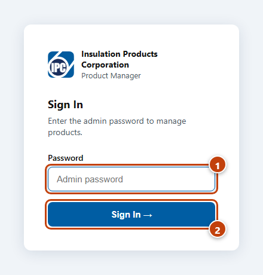

1. Type the password.
2. Click **Sign In**.

Please change it to something of your own the first time you sign in: click **Account** at the right-hand end of the menu bar, then **Password**.

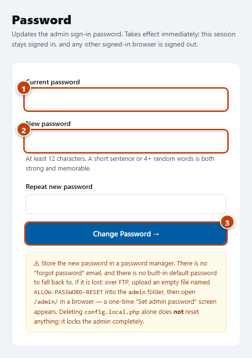

1. The password you signed in with.
2. Your new one (at least 12 characters — a short sentence is both strong and easy to remember), then the same again in the box underneath.
3. Click **Change Password**.

There's no "forgot password" email on a site this size, so store it somewhere you'll still have in a year — a password manager, or written down somewhere safe. If it ever does get lost, call me; I can reset it for you over FTP in about two minutes.

## 3. Where you land: the Overview

After signing in you land on the **Overview** — one page that answers "does anything need me today?". Looking at it doesn't change anything.

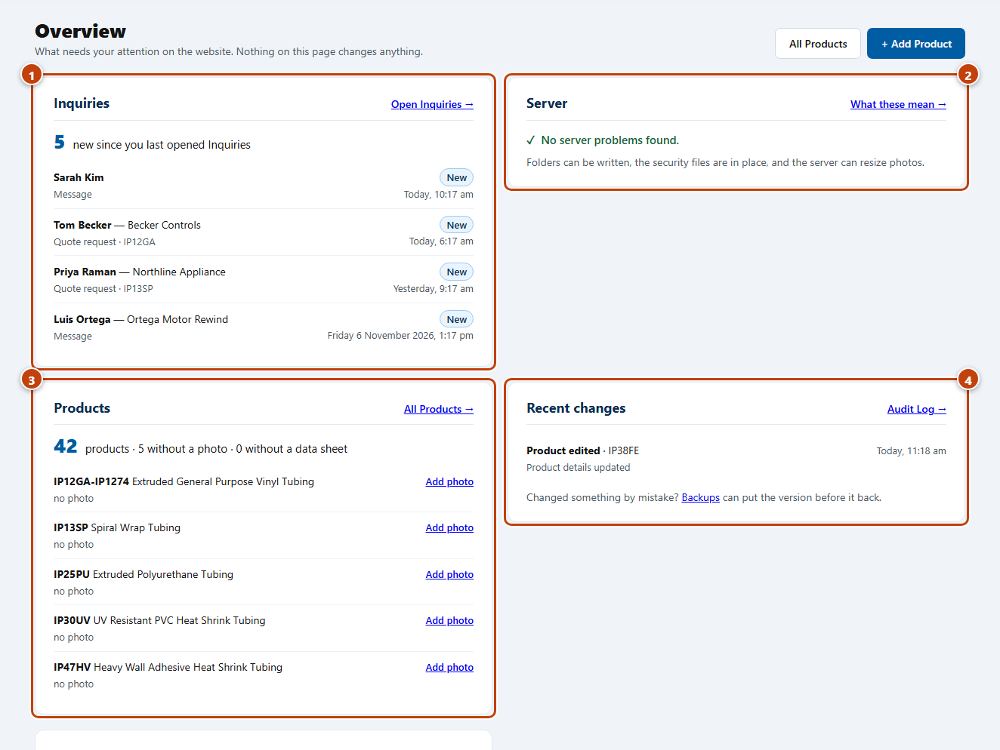

1. **Inquiries** — new quote requests and messages from the website.
2. **Server** — a green tick means all is well. If it ever shows a problem, send me a screenshot; that one's mine to fix, not yours.
3. **Products** — products still missing a photo or a data sheet, with a link straight to the page that adds one.
4. **Recent changes** — the last few things saved in the dashboard.

The menu bar across the top is the same on every page and stays on screen while you scroll:

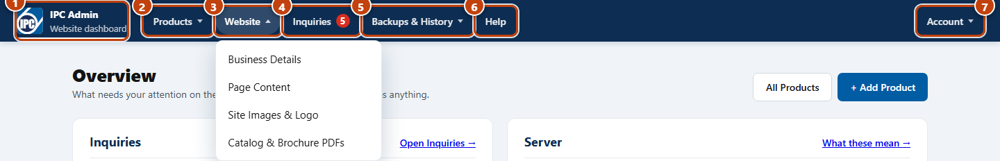

1. **IPC Admin** — click it to come back to the Overview.
2. **Products** — All Products, Add Product.
3. **Website** (shown open) — Business Details, Page Content, Site Images & Logo, Catalog & Brochure PDFs.
4. **Inquiries** — the red number is how many new leads you haven't looked at yet.
5. **Backups & History** — Backups (undo) and the Audit Log.
6. **Help** — the full guide.
7. **Account** — Password, View Live Site, Sign Out.

## 4. Your products

**Products → All Products** lists every product on the site.

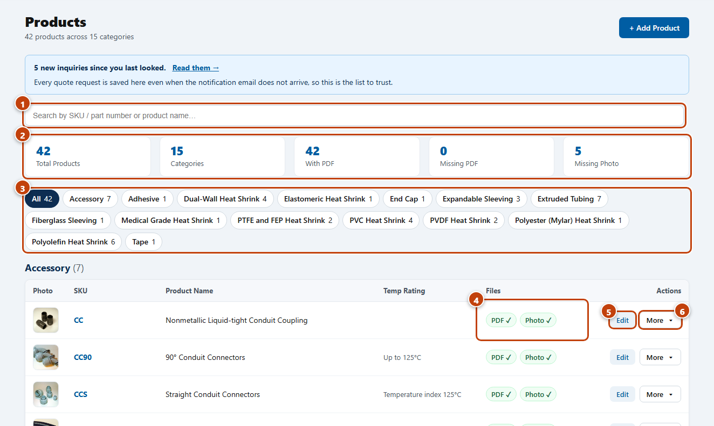

1. Search by part number or name.
2. Counts at a glance — "Missing PDF" or "Missing Photo" above zero is a to-do list.
3. Show one category at a time.
4. Green = it has its data sheet and photo; amber = one is missing.
5. **Edit** — change anything about the product.
6. **More** — Manage PDF, Photo, View on site, and Delete.

**Changing a product.** Click **Edit**, change what you need, and click **Save Changes**. The panel on the right shows the product page exactly as the website will, and updates as you type.

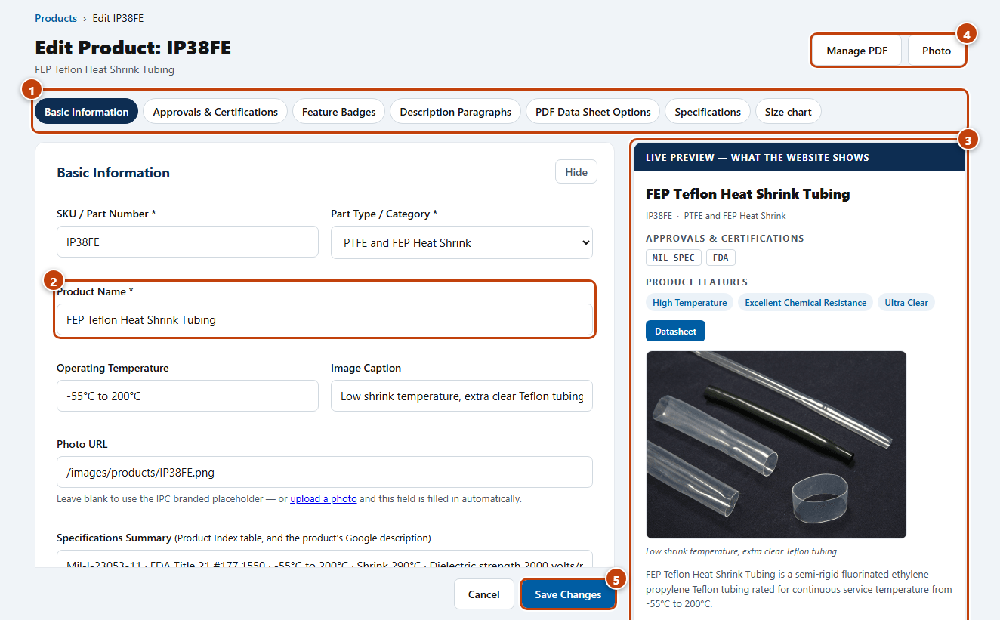

1. Jump to a part of the form: Approvals, Feature Badges, Specifications, Size chart and so on.
2. The boxes — here, the product's name.
3. The live preview — nothing is on the website until you save.
4. The data sheet and photo are changed on their own pages.
5. **Save Changes** — always at the bottom of the screen.

You'll come back to the product list with a green message confirming the save:

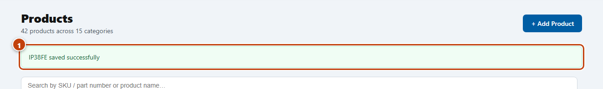

**Adding a product.** **Products → Add Product**. Only three boxes are required — the part number, the category and the name. Add the photo and the data sheet afterwards, from the product's **More** menu.

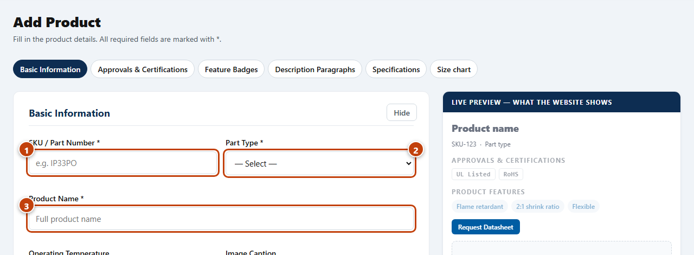

**A photo or a data sheet.** On the product's row, click **More**, then **Photo** or **Manage PDF**. Choose the file on your computer and click the upload button — nothing else to do. Photos can come straight off your phone; the site resizes them.

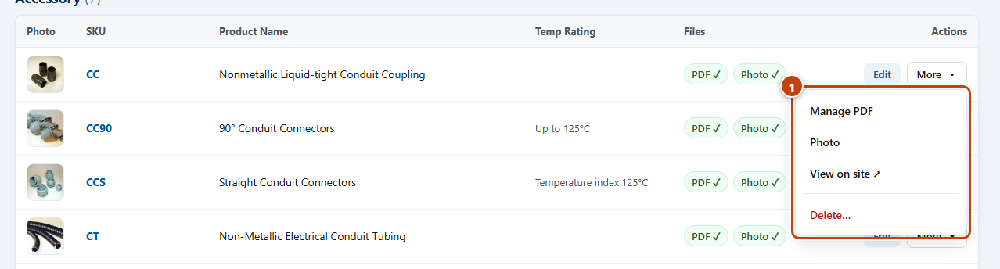

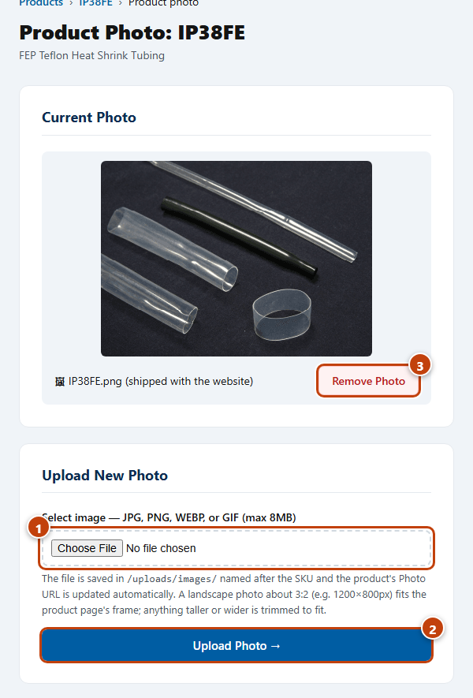

1. **Choose File** — pick the picture.
2. **Upload Photo**.
3. **Remove Photo** goes back to the "image coming soon" panel.

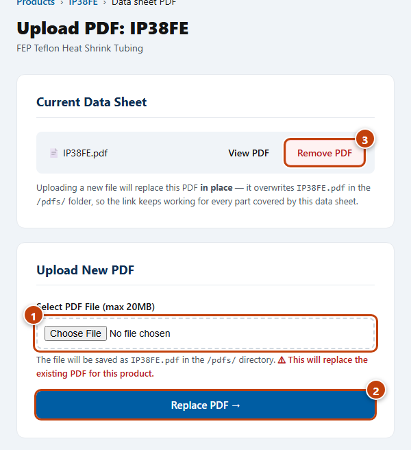

1. **Choose File** — pick the PDF.
2. **Upload PDF** (it says **Replace PDF** when the product already has one).
3. **Remove PDF**.

## 5. Your business details

**Website → Business Details** holds the facts about IPC that appear all over the site: phone, fax, email, address, hours, certifications, the minimum order, social links, colors and logo.

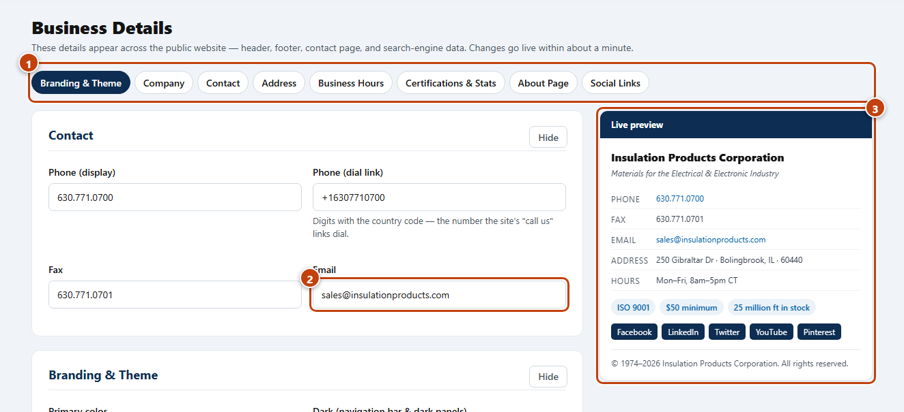

1. Jump to a section.
2. **Email** — this is also the address every quote request from the website is sent to. Change it and new leads go to the new address.
3. A live preview of how your details will read on the site.

## 6. The wording on your pages

**Website → Page Content** holds every heading, paragraph, card, FAQ question, menu link and the privacy policy. It's laid out in the same order as the website.

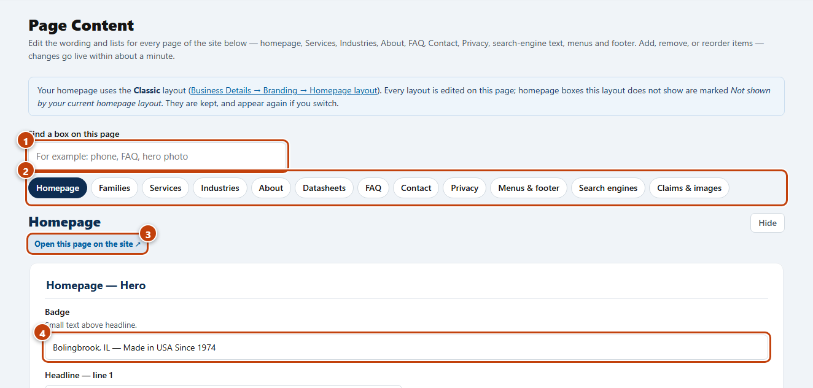

1. **Find a box on this page** — type a word like *phone* or *FAQ* and only the matching boxes stay on screen.
2. Jump to a page of the website.
3. Open that page of the website in a new tab, to look while you edit.
4. A box — type the new wording, then click **Save Content** at the bottom of the screen.

Lists — the FAQ, the services, the industries, the menus — have buttons to reorder, remove and add rows:

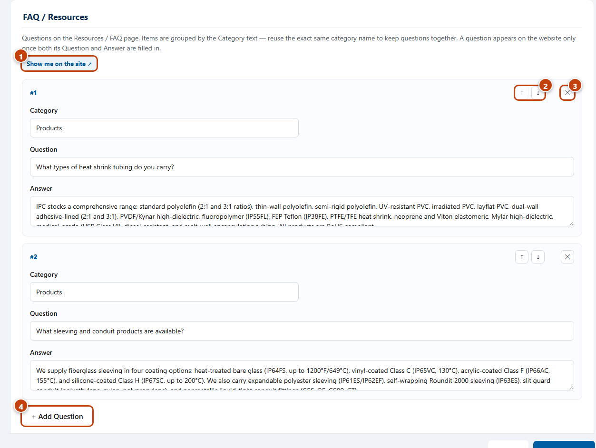

1. Opens the website at this very section.
2. Move a row up or down.
3. Remove it (you're asked first).
4. Add a new one at the bottom.

**Page photos and your logo** are on **Website → Site Images & Logo**: one card per photo, showing what's on the site now, with an upload button.

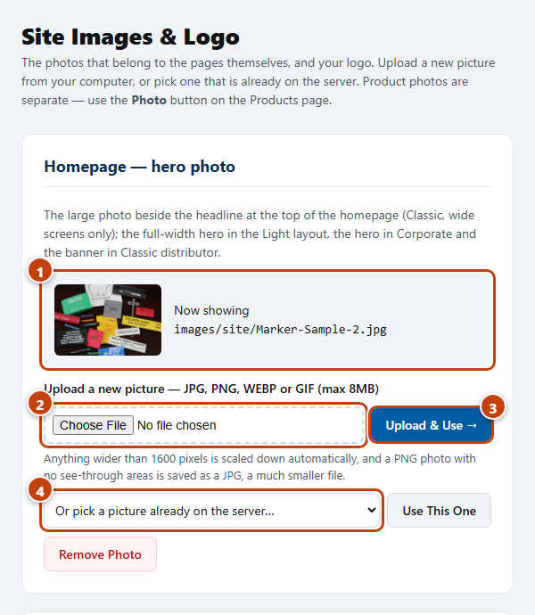

1. What is on the website now.
2. **Choose File**…
3. …then **Upload & Use**. It's on the site straight away.
4. Or reuse a picture already on the server.

**Your full catalog PDF and brochures** go on **Website → Catalog & Brochure PDFs** — the same idea, for PDFs that aren't one product's data sheet.

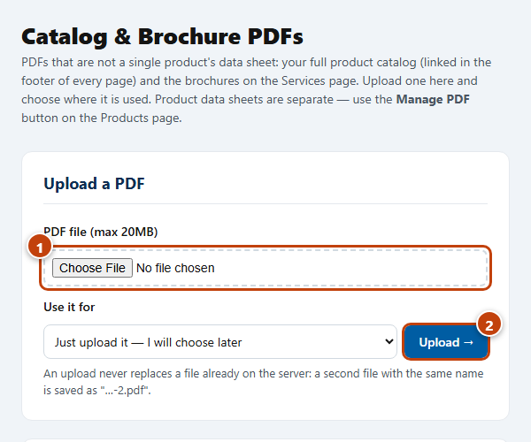

## 7. Quote requests and messages

When a customer fills in the form on the Contact page, two things happen: you get an email at the address in Business Details, **and** a copy is saved in the dashboard under **Inquiries**. So even if an email goes astray, the lead isn't lost.

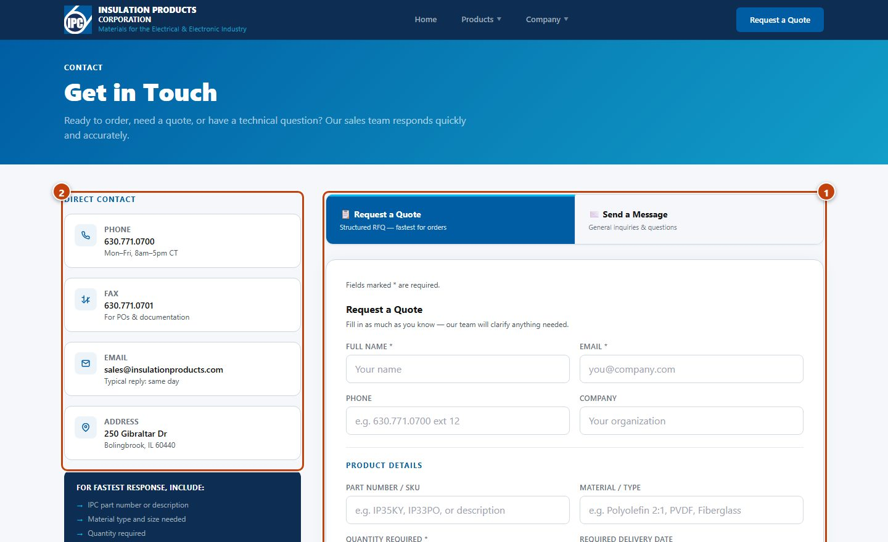

1. The form — a quote request, or a general message.
2. Your phone, fax, email and address, from Business Details.

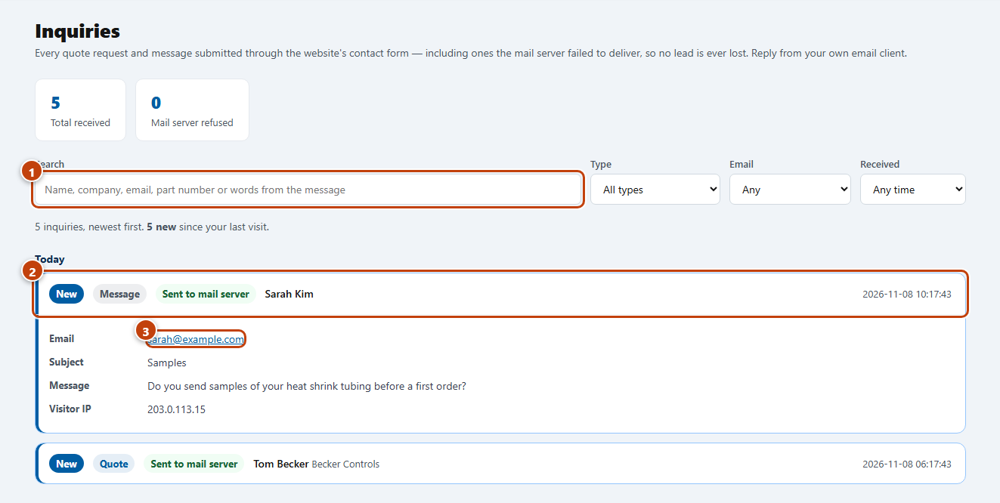

1. Search by name, company, part number or any word from the message.
2. One lead — click it to open it. *New* means you haven't seen it yet.
3. Click the email address to reply from your own email.

(The names in these pictures are made up.)

## 8. Your safety net: Backups and the Audit Log

Every save keeps a copy of how things were just before it. If something ever saves wrong, open **Backups & History → Backups** and restore the entry stamped with the time you saved the change you want to undo — you can do this yourself, and a restore can itself be undone.

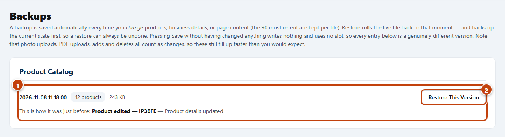

1. The time of the save, and the change that restoring it would undo.
2. **Restore This Version**.

One exception: uploading a new data sheet over an existing one (or a new photo over one you uploaded earlier) replaces the old file for good, so keep a copy of the old one first.

**Backups & History → Audit Log** lists every change made in the dashboard, newest first — handy for finding when something changed before you restore it.

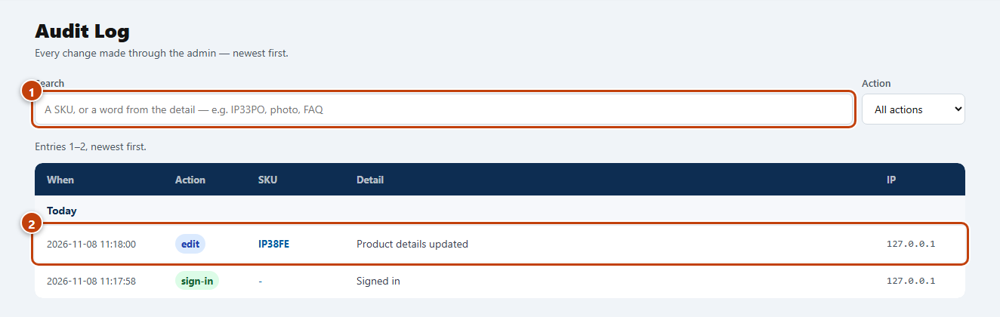

1. Search by part number or a word like *photo*.
2. One change: when, what kind, which product, and what was done.

## 9. The Help page

Everything above, and much more, is in the dashboard itself: click **Help** in the menu bar. It now has these same pictures in it, it's always there, and it matches exactly what's on your screen — including a troubleshooting section and a glossary.

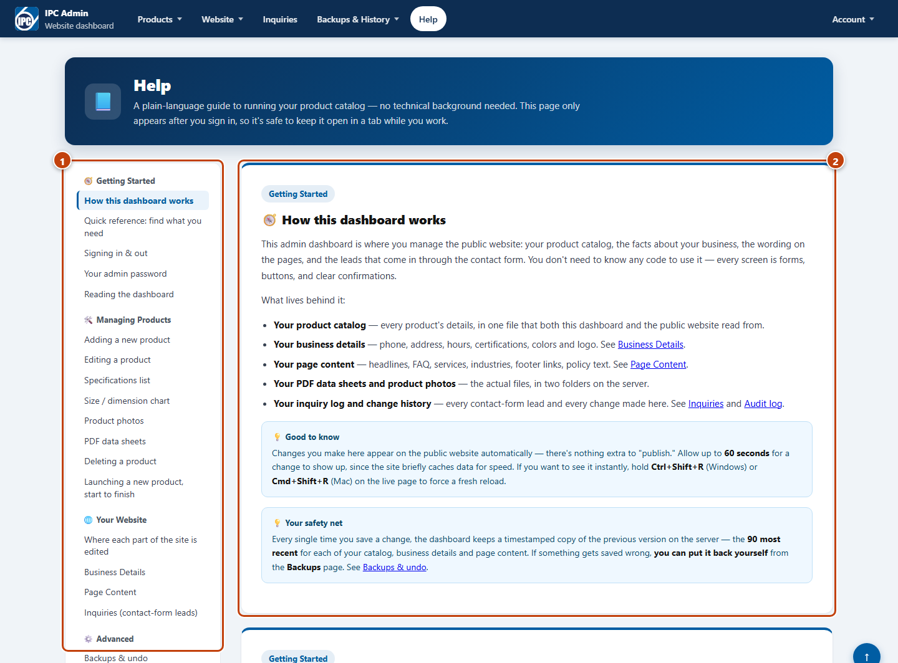

1. The list of topics — click one to jump to it.
2. The guide itself.

If you were sent an earlier Word document (*IPC Admin Dashboard – Help and Documentation.docx*), **please delete it.** Several parts of it are now wrong. The Help page replaces it.

**A few tips**

- Bookmark the admin address for quick access.
- Changes appear on the website within about a minute. If you don't see one, hold Ctrl and press Shift+R on the website page to force a refresh.
- If a page won't save, or the dashboard shows a red banner about the server, send me a screenshot — that one's mine to fix, not yours.

## 10. Please check these — facts only you can confirm

The website says these things about IPC. Most came from the old website, and nothing on my side can prove them, so please look them over. Each one is a box in the dashboard: check it says what's true, and change or empty it if not. If it's easier, send me your answers and I'll make the changes.

**Certifications**

- **ISO 9001** (Business Details → Certifications): type it the way your current certificate shows it, including the revision year — for example **ISO 9001:2015**, not just "2015" — or empty the box if you'd rather the site not claim it. Emptying it takes it off the footer, the About page fact box and the homepage band; other places that mention ISO 9001 in their own words (some Page Content cards, the About story, and the VALUE-ADDED product) stay until you edit them — Business Details lists every one of them after you save.
- **"RoHS compliant — entire line"**: only 2 of the 42 products say RoHS on their data sheets. It appears in Page Content (About — Certifications & Standards, Homepage — Hero Trust Ticker, the RoHS question in the FAQ, and the Products & Services Cards) and in Business Details → About Page. Keep it only if it's true for every product.
- **AMS specifications**: which AMS specs does IPC actually hold? They're mentioned in Page Content (Hero Trust Ticker, About — Certifications & Standards, Industries Grid, Industries Page — Detail Sections, FAQ) and Business Details → About Page.
- **Approval marks on the products** (Products → Edit): many products say things like "U/L Approved", "CSA Approved" or "FDA Approved". UL, CSA and the FDA don't issue approvals by those names (UL, for example, *lists* or *recognizes* a product). Please tell me which marks each product really holds — then we'll get the spelling of UL, CSA, MIL-SPEC, AMS and RoHS to match your certificates.

**Promises the site makes**

- 25 million+ feet in stock, a $50 minimum order, same- or next-business-day shipping, custom work in a week or less, JIT programs, PPAP and IMDS packages, certificates of conformance — are all of these still true? (The minimum order and feet in stock are in Business Details; empty the Minimum Order box if there is no minimum.)
- A few specific claims I couldn't back up from the data sheets: "Ford LP Approved Variants", "M23053/8 QPL Available", "Class C" for the 130°C vinyl-coated fiberglass sleeving (130°C is usually Class B), cable ties as a stocked item (they're not among the 42 products), "clean room environment", services shipping "in one week or less" (the Hot-Stamp brochure says one to two weeks), and the CT conduit described as "Liquid-Tight … UL & CUL Listed" on the Industries page but "Non-Metallic Electrical Conduit Tubing" on its own page.
- **Search engines** boxes (Page Content → Company Claims): these tell Google the brand and manufacturer of every product. IPC is a distributor — if IPC doesn't make a product, correct or empty them.

**The catalog**

- In October I corrected 35 product records to match their own data sheets (specifications, approval marks, categories). Please glance over your main products. A few questions are still open because the data sheet itself is unclear:
  - Which IP1274 data sheet is the current one?
  - IP33PO: are the 5" and 6" sizes real? They're not on its sheet.
  - IP30HS: the 5/16" recovered diameter.
  - IP17TW: the low temperature limit (the text says -70°C, the spec says -275°F).
  - IP49VP: tensile strength "+/- 5%"; IP69HT: elongation "600 P.S.I."
  - IP3L: cold brittleness "20°C" — probably -20°C?
  - IP52EC: its operating temperature (currently blank).
  - IP55FL: AMS-3632C; Slit Guard: UL-94 V2 on the polypropylene version; IP10EX: the badge "U/L CSA Certified"; CT: "except where noted".
- Two badges are spelled two ways — "Low Temperature Flexibility" / "Low-Temperature Flexibility" and "125°C Rated" / "Rated 125°C". Pick one of each.
- Five products have no photo yet and show an "image coming soon" panel: IP12GA-IP1274, IP13SP, IP25PU, IP30UV, IP47HV. The Overview lists them with an **Add photo** link.

**Everything else**

- **FAQ**: question 15, and the answer that says to click the "Data Sheet" button — the button now reads "Datasheet". (The homepage's "Datasheets Published" number, which replaced "42 Products Stocked", now counts itself from the catalog.)
- **Privacy policy**: the effective date (Page Content → Privacy), and the "Data Retention" section, which now says a visitor can email to have their details removed, and that we then remove them by hand. Please approve that wording or change it.
- **Social links** (Business Details): only accounts you actually run.
- **Photos** (Site Images & Logo): swap in your own wherever you'd like.

I'm happy to hop on a quick call and walk through it together if that would help — otherwise, feel free to reach out anytime with questions.

Best,
Keagan
